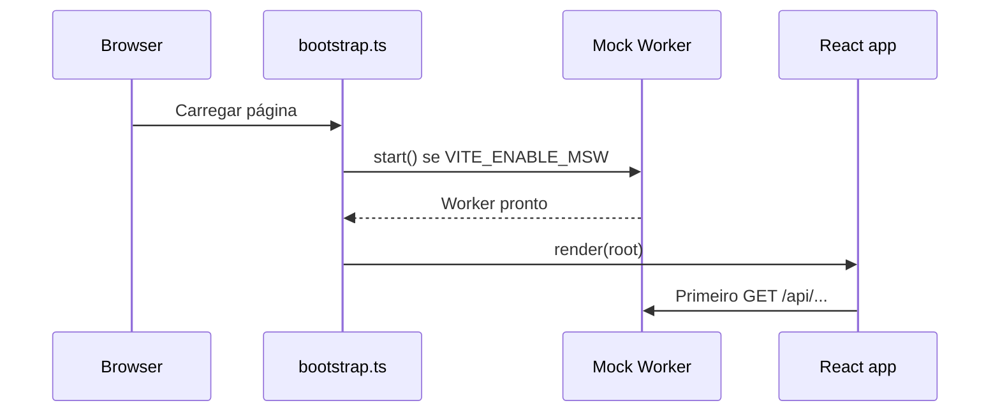

# Operação local — roteiro de instalação proposto

Este documento descreve **como o projeto deve ser configurado quando implementado**, não comandos que foram executados nesta entrega de documentação.

## Pré-requisitos

- Node.js LTS compatível com as versões efetivamente instaladas.
- Gerenciador de pacotes escolhido (proposta: `pnpm`); versionar o lockfile.
- Chromium para Playwright; navegador com suporte a Service Worker/WebSocket.
- Nenhum PostgreSQL, Docker, serviço de blockchain ou backend privado necessário para demonstrar a aplicação.

## Sequência planejada

```bash
pnpm install --frozen-lockfile
pnpm exec playwright install chromium
pnpm dev
# em outro terminal
pnpm typecheck
pnpm lint
pnpm build
pnpm test:e2e
pnpm preview
```

**[VALIDAR]** Os scripts acima serão reais apenas depois de `package.json` implementado. `pnpm typecheck` precisa apontar para o tsconfig correto do Vite. `pnpm test:e2e` depende do servidor Playwright/webServer configurado.

## Variáveis de ambiente sugeridas

```dotenv
VITE_ENABLE_MSW=true
VITE_API_BASE_URL=/api
VITE_SOCKET_URL=ws://localhost:5173
VITE_DEMO_SCENARIO=default
```

`VITE_SOCKET_URL` é ilustrativa; WebSocket endpoint/path, protocolo (`ws/wss`) e origem precisam ser validados conforme o binding e a hospedagem. Não armazenar segredos reais em `VITE_*` (ficam expostos no bundle do navegador).

## Inicialização obrigatória



Iniciar React antes do worker pode produzir requisições sem interceptação. Em preview e deploy, garantir `mockServiceWorker.js` servido no escopo correto.

## Mock control / reset (proposta)

- `POST /api/__test/reset` para restaurar fixture.
- `POST /api/__test/scenario` para selecionar falha/latência/pagamento.
- `POST /api/__test/event` para causar alteração no mock store e **emitir evento via Socket.IO**.
- Restringir esses endpoints à demo/testes e documentá-los claramente; não tratá-los como API de negócio.

## Diagnóstico

| Sintoma | Verificar |
|---|---|
| API não intercepta | worker registrado, caminho, escopo, configuração |
| WebSocket não conecta | handshake, endpoint, transports e compatibilidade binding |
| Rotas quebram no refresh | configuração de rewrite SPA para `index.html` |
| E2E varia entre execuções | reset, cookie/sessão, relógio, storage e ordem de testes |
| Build passa e deploy não | prefixo de assets, import.meta.env, worker público e WSS |

[Deploy](deploy-e-validacao.md) · [Índice](../README.md)
