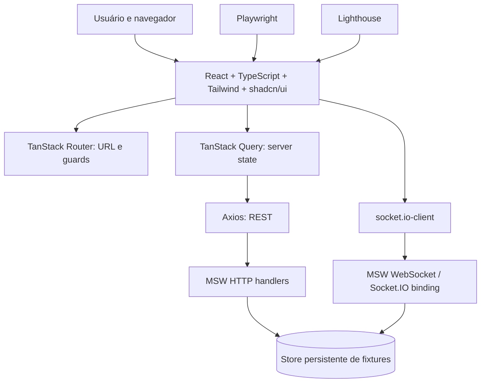

# ARCHITECTURE — Decisões e mapa de engenharia

> **Status do projeto:** especificação proposta, sem implementação verificada. Fonte obrigatória: [README oficial](https://github.com/junglegaming/frontend-challenge) e protótipo no Pencil (pen.dev), consultado pela conexão MCP.

## 1. O problema a resolver

Criar um marketplace de NFTs (totalmente simulado) com descoberta, carrinho, conta e compra segura *dentro das regras da simulação*, exibindo alterações em tempo real e recuperando falhas. A UI segue o protótipo inspecionado pelo MCP do Pencil; a simulação obedece ao README. Não usar backend privado como pré-requisito para o deploy público.

## 2. Visão geral da solução

## 3. Decisões e limites

| Decisão | Motivo | Documento detalhado |
|---|---|---|
| Vite + React TS | TanStack Router obrigatório e build simples | [ADR-001](03-arquitetura/adr/ADR-001-build-e-estado.md) |
| MSW como única API da demo | Backend simulável/persistente e deploy estático | [Persistência](03-arquitetura/persistencia-e-fronteiras.md) |
| Query para dados remotos | Cache, invalidação, cancelamento e rollback | [Modelo de estado](03-arquitetura/modelo-de-estado.md) |
| ETH decimal string | Precisão no transporte e cálculo | [ETH](03-arquitetura/valores-em-eth.md) |
| Checkout idempotente | Evitar compra duplicada | [ADR-002](03-arquitetura/adr/ADR-002-cotacao-idempotencia.md) |
| Socket.IO via MSW | Obrigação de protocolo real no cliente | [ADR-003](03-arquitetura/adr/ADR-003-socket-io-msw.md) |
| Isolamento lógico de identidades | Sem vazamento entre contas em simulação | [ADR-004](03-arquitetura/adr/ADR-004-seguranca-no-mock.md) |
| Feature-based modules | Legibilidade, ownership e independência | [Catálogo de módulos](03-arquitetura/catalogo-de-modulos.md) |

## 4. Quatro fontes da verdade

1. **URL via Router** para busca, filtros, sort, página e navegação.
2. **MSW/store** para estado de domínio: preço, estoque, autenticação, carrinho, pedidos e carteiras.
3. **TanStack Query** como cache de cópias dessas respostas; não substitui a fonte.
4. **React local** só para estado visual transitório; não guarda cotação como autoridade.

Socket.IO é o canal de notificação versionada, seguido de reconciliação REST. Não pode substituir a API nem usar atalhos de estado na UI.

## 5. Fluxos críticos

- **Descoberta:** Router params → Query key → Axios → MSW → catálogo/detalhe, estados de falha e URL persistente.
- **Conta:** Router guard + API session + identity scope; logout limpa QueryClient e listeners.
- **Carrinho:** edição e estoque validado; visitante persiste e faz merge transacional após login.
- **Compra:** quote autoritativa → revisão → `Idempotency-Key` → pedido pending → evento/REST → confirmed/declined → snapshot de recibo.
- **Tempo real:** evento versionado e com ownerScope → ignorar duplicatas/antigos → invalidar/reconciliar.

## 6. Mapa de aprofundamento

**Primeiro:** [RF](01-visao-geral/requisitos-funcionais.md) · [RNF](01-visao-geral/requisitos-nao-funcionais.md) · [Regras](01-visao-geral/regras-de-negocio.md).  
**Depois:** [C4](03-arquitetura/mapa-c4.md) · [Pastas](03-arquitetura/estrutura-de-pastas.md) · [Modelo de dados](03-arquitetura/modelo-de-dados.md) · [Flows](02-produto/casos-de-uso.md).  
**Implementar:** [Contracts](05-integracoes/especificacao-de-contratos.md) · [Eventos](05-integracoes/contrato-de-eventos.md) · [Código](06-qualidade/qualidade-de-codigo.md).  
**Validar:** [Segurança](06-qualidade/seguranca-aplicacional.md) · [Testes](06-qualidade/estrategia-de-testes.md) · [Matriz](06-qualidade/matriz-de-testes-e-requisitos.md) · [TASKS](TASKS.md).
