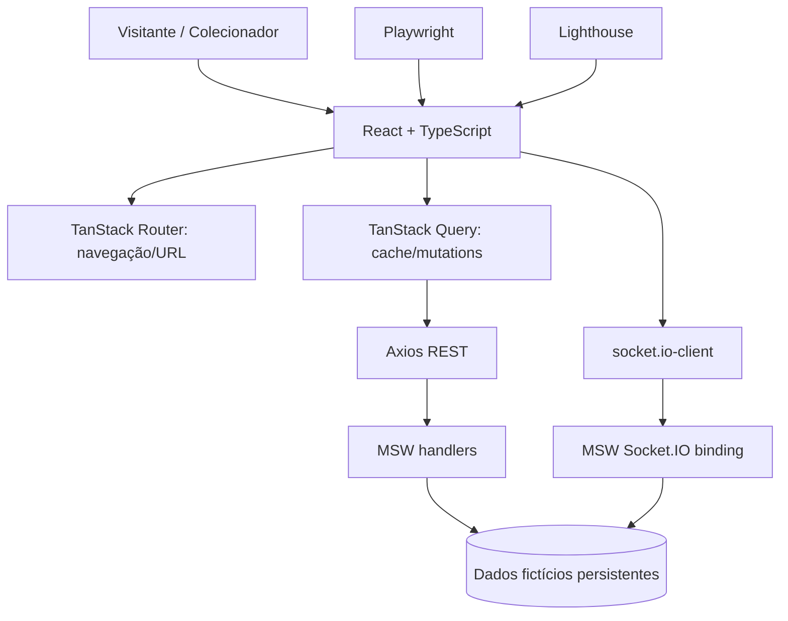

# NFT Marketplace — Especificação de produto e engenharia

> **Projeto:** Frontend Challenge — Jungle Gaming. **Status:** documentação de planejamento: não prova implementação nem aprova resultados de testes. **Atualizado:** 05/11/2026. **Linguagem:** pt-BR.

A documentação foi organizada para evitar divergências entre desenvolvimento de UI, regras de negócio, integração com MSW/Socket.IO, segurança, testes e agentes Codex. Os arquivos são Markdown e os diagramas são **Mermaid editável**, renderizáveis no GitHub.

## Comece por aqui — trilha de leitura

1. **O que entregar:** [RF-001 a RF-059](01-visao-geral/requisitos-funcionais.md), [RNF-001 a RNF-030](01-visao-geral/requisitos-nao-funcionais.md) e [RN-001 a RN-030](01-visao-geral/regras-de-negocio.md).
2. **Como o usuário usa:** [Mapa de navegação](02-produto/mapa-de-navegacao.md) → [Casos de uso](02-produto/casos-de-uso.md) → [Checkout detalhado](02-produto/fluxos/checkout.md).
3. **Como o sistema funciona:** [ARCHITECTURE.md](ARCHITECTURE.md) → [C4](03-arquitetura/mapa-c4.md) → [Estrutura de pastas](03-arquitetura/estrutura-de-pastas.md) → [Módulos](03-arquitetura/catalogo-de-modulos.md).
4. **Como os dados circulam:** [Contratos REST](05-integracoes/especificacao-de-contratos.md) → [Eventos Socket.IO](05-integracoes/contrato-de-eventos.md) → [Estado](03-arquitetura/modelo-de-estado.md).
5. **Como manter a qualidade:** [Código](06-qualidade/qualidade-de-codigo.md) → [Segurança](06-qualidade/seguranca-aplicacional.md) → [Testes](06-qualidade/estrategia-de-testes.md) → [Matriz RF/testes](06-qualidade/matriz-de-testes-e-requisitos.md).
6. **Como implementar:** [TASKS.md](TASKS.md), [AGENTS.md](AGENTS.md), [Definition of Done](06-qualidade/definition-of-done.md).

## Sistema em uma visão

### Vocabulário de status

- **[EXIGIDO]**: requisito explícito no README oficial.
- **[PROPOSTO]**: decisão arquitetural/operacional sugerida (pode ser revista por ADR).
- **[VALIDAR]**: depende de inspeção do protótipo pelo MCP do Pencil, spike ou execução.
- **[IMPLEMENTADO]/[TESTADO]**: somente quando houver código e evidência; nesta entrega, não se presume aprovação.

**Fontes:** [Repositório oficial](https://github.com/junglegaming/frontend-challenge) e protótipo no Pencil (pen.dev), acessado pela conexão MCP. O [Figma citado no enunciado](https://www.figma.com/design/Ff0SksUi7UFtPWUO8kyNtw/Frontend-Challenge?node-id=0-1) é referência de origem; não será usado para visualizar o protótipo.

## Índice completo por área
### 00-comecar — Orientação e governança da documentação

- [Relatório de verificação documental](00-comecar/relatorio-de-verificacao.md)

- [Contrato de documentação — como evitar desvio de escopo](00-comecar/contrato-da-documentacao.md)
- [Glossário de arquitetura e produto](00-comecar/glossario.md)
- [Guia de leitura e uso da documentação](00-comecar/guia-de-leitura.md)

### 01-visao-geral — Requisitos, atores e regras de negócio

- [Atores, perfis de acesso e autorização](01-visao-geral/atores-e-permissoes.md)
- [Matriz de rastreabilidade de requisitos](01-visao-geral/matriz-de-rastreabilidade.md)
- [Premissas, restrições, escopo e pendências](01-visao-geral/premissas-restricoes-e-fora-de-escopo.md)
- [Regras de negócio e invariantes (RN)](01-visao-geral/regras-de-negocio.md)
- [Catálogo de requisitos funcionais (RF)](01-visao-geral/requisitos-funcionais.md)
- [Requisitos não funcionais (RNF)](01-visao-geral/requisitos-nao-funcionais.md)
- [Stack e responsabilidades](01-visao-geral/stack.md)
- [Visão geral e objetivo](01-visao-geral/visao-e-escopo.md)

### 02-produto — Produto, navegação, casos de uso e jornadas

- [Casos de uso — contratos de interação](02-produto/casos-de-uso.md)
- [Fluxo detalhado — login, sessão e troca de usuário](02-produto/fluxos/autenticacao.md)
- [Fluxo detalhado — carrinho, cupom e merge](02-produto/fluxos/carrinho.md)
- [Fluxo detalhado — compra, idempotência e recuperação](02-produto/fluxos/checkout.md)
- [Fluxo detalhado — perfil, senha e carteiras](02-produto/fluxos/conta-e-carteiras.md)
- [Fluxo detalhado — descoberta, filtros e detalhe](02-produto/fluxos/descoberta.md)
- [Fluxos de exceção e recuperação](02-produto/fluxos/erros-e-recuperacao.md)
- [Carrinho](02-produto/funcionalidades/carrinho.md)
- [Catálogo e detalhes](02-produto/funcionalidades/catalogo-e-detalhes.md)
- [Conta, sessão e carteiras](02-produto/funcionalidades/conta-sessao-e-carteiras.md)
- [Pagamento e pedidos](02-produto/funcionalidades/pagamento-e-pedidos.md)
- [Jornadas de usuário e navegação](02-produto/jornadas-e-fluxos.md)
- [Mapa de navegação e rotas](02-produto/mapa-de-navegacao.md)
- [Telas, rotas e permissões](02-produto/telas-e-rotas.md)

### 03-arquitetura — Arquitetura de sistemas, módulos, dados e ADRs

- [ADR-001 — Build, roteamento e fonte da verdade](03-arquitetura/adr/ADR-001-build-e-estado.md)
- [ADR-002 — Autoridade da cotação e idempotência](03-arquitetura/adr/ADR-002-cotacao-idempotencia.md)
- [ADR-003 — Simulação de Socket.IO com MSW](03-arquitetura/adr/ADR-003-socket-io-msw.md)
- [ADR-004 — Segurança lógica em ambiente totalmente simulado](03-arquitetura/adr/ADR-004-seguranca-no-mock.md)
- [Arquitetura e organização](03-arquitetura/arquitetura-e-estado.md)
- [Catálogo de módulos e contratos públicos](03-arquitetura/catalogo-de-modulos.md)
- [ADR — Registros de decisão arquitetural](03-arquitetura/decisoes-arquiteturais.md)
- [Estrutura de diretórios — quem faz o quê](03-arquitetura/estrutura-de-pastas.md)
- [Dependências entre módulos e fluxos de dados](03-arquitetura/fluxo-de-dependencias.md)
- [Limites arquiteturais, dependências e responsabilidades](03-arquitetura/limites-e-responsabilidades.md)
- [Mapa C4 — Contexto, containers e limites](03-arquitetura/mapa-c4.md)
- [Modelo de dados — domínio e relacionamentos](03-arquitetura/modelo-de-dados.md)
- [Modelo de estado — UI, URL, cache, sessão e tempo real](03-arquitetura/modelo-de-estado.md)
- [Estratégia de persistência e fronteiras da simulação](03-arquitetura/persistencia-e-fronteiras.md)
- [Valores em ETH e integridade monetária](03-arquitetura/valores-em-eth.md)

### 04-design-system — Design system, telas e acessibilidade de UI

- [Acessibilidade e comportamento responsivo](04-design-system/acessibilidade-e-responsividade.md)
- [Contrato de componentes e composição](04-design-system/contrato-de-componentes.md)
- [Especificação das nove telas e seus estados](04-design-system/especificacao-das-telas.md)
- [Inventário do protótipo no Pencil, componentes e assets](04-design-system/inventario-figma.md)
- [Design system e fidelidade visual](04-design-system/tokens-e-componentes.md)

### 05-integracoes — REST, mocks, persistência, eventos e erros

- [Autenticação, sessão e isolamento por usuário](05-integracoes/autenticacao-e-sessao.md)
- [Catálogo de falhas, mensagens e recuperação](05-integracoes/catalogo-de-erros.md)
- [Política de erros e repetição de operações](05-integracoes/contrato-de-erro-e-retry.md)
- [Catálogo de eventos Socket.IO — contratos e ordenação](05-integracoes/contrato-de-eventos.md)
- [Contratos REST propostos](05-integracoes/contratos-rest.md)
- [Dicionário de dados e identificadores de domínio](05-integracoes/dicionario-de-dados.md)
- [Contratos REST — especificação proposta](05-integracoes/especificacao-de-contratos.md)
- [Idempotência, concorrência e recuperação](05-integracoes/idempotencia-e-recuperacao.md)
- [Máquinas de estado — checkout, pedido, carteira e UI](05-integracoes/maquinas-de-estado.md)
- [MSW, fixtures e cenários](05-integracoes/mocks-e-cenarios.md)
- [Tempo real com Socket.IO](05-integracoes/tempo-real.md)

### 06-qualidade — Qualidade de software, segurança, testes e rastreabilidade

- [Acessibilidade e usabilidade inclusiva](06-qualidade/acessibilidade.md)
- [Definition of Ready / Definition of Done](06-qualidade/definition-of-done.md)
- [Estratégia de testes e pirâmide de qualidade](06-qualidade/estrategia-de-testes.md)
- [Lighthouse e desempenho](06-qualidade/lighthouse-e-performance.md)
- [Matriz de aceitação — requisito → cenário → evidência](06-qualidade/matriz-de-aceitacao.md)
- [Matriz de rastreabilidade RF → testes e evidências](06-qualidade/matriz-de-testes-e-requisitos.md)
- [Observabilidade, erros e comunicação de falhas](06-qualidade/observabilidade-e-feedback.md)
- [Qualidade de código — convenções, princípios e verificação](06-qualidade/qualidade-de-codigo.md)
- [Checklist de revisão de código e convenções de contribuição](06-qualidade/revisao-de-codigo.md)
- [Segurança de aplicação — threat model, controles e limites](06-qualidade/seguranca-aplicacional.md)
- [Segurança, privacidade e modelo de ameaça da simulação](06-qualidade/seguranca-e-privacidade.md)
- [Estratégia de testes](06-qualidade/testes.md)

### 07-planejamento — Planejamento técnico, riscos e governança

- [Critérios de avaliação e eliminatórios](07-planejamento/criterios-de-avaliacao.md)
- [Pendências e decisões a confirmar](07-planejamento/decisoes-pendentes.md)
- [Governança de mudanças e controle de arquitetura](07-planejamento/governanca-de-mudancas.md)
- [Plano de implementação por marcos](07-planejamento/marcos-de-implementacao.md)
- [Riscos técnicos, impacto e planos de contingência](07-planejamento/riscos-e-contingencias.md)
- [Roadmap de implementação por fatias verticais](07-planejamento/roadmap-de-features.md)
- [Spikes técnicos prioritários e caminhos críticos](07-planejamento/spikes-e-dependencias.md)

### 08-entrega — Execução, auditoria, deploy e entrega

- [Checklist final](08-entrega/checklist-final.md)
- [Deploy e validação da demonstração pública](08-entrega/deploy-e-validacao.md)
- [Guia de verificação, evidências e entrega](08-entrega/guia-de-verificacao.md)
- [Operação local — roteiro de instalação proposto](08-entrega/operacao-local.md)
- [Entrega e documentação final do repositório](08-entrega/orientacoes-de-entrega.md)

### 09-referencias — Fontes e referências externas

- [Fontes, precedência e limites desta especificação](09-referencias/fontes-e-limites.md)
- [Referências normativas e guias técnicos](09-referencias/referencias-de-qualidade.md)
## Como manter este pacote consistente

A cada mudança: atualizar requisito → arquitetura/contrato → feature → teste/evidência → `TASKS.md`. Não modificar o enunciado para fazer a implementação parecer concluída. Toda decisão nova precisa identificar se é exigida ou proposta.

**Critérios eliminatórios que não podem ser omitidos:** stack efetiva, fluxos reais (não apenas visuais), confirmação de compra somente pela simulação, isolamento de contas, Socket.IO real via MSW e testes Playwright executáveis.

**Fora do escopo primário:** banco de dados PostgreSQL/Docker, carteiras e pagamentos reais, blockchain real, backend produtivo. Se forem explorados em laboratório, a entrega pública precisa continuar 100% funcional com mocks MSW.
