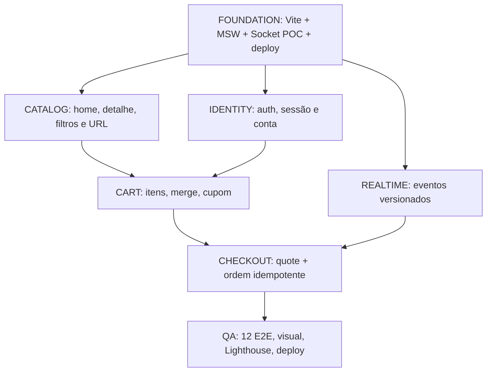

# TASKS — Plano executável por milestones

> **Status:** itens marcados foram comprovados no escopo descrito; itens desmarcados permanecem pendentes, mesmo quando há trabalho parcial. `RF`, `RNF` e `RN` referem-se aos documentos de requisitos e regras de negócio. Critério eliminatório precede refinamento secundário.

## Roadmap e dependências



## M0 — Fundação e viabilidade do desafio

- [x] `M0-01` — Instalar Vite/React/TS strict, Tailwind/shadcn, Router, Query, Axios, MSW, Playwright (RNF-001/019). **Validado:** configuração, build e smoke tests; UI e rotas são uma fundação, não as telas finais.
- [ ] `M0-02` — Definir schemas/DTOs e query keys compartilhadas (RF-001–RF-049). **Parcial:** existe schema Zod somente para diagnóstico; faltam contratos de domínio e query keys compartilhadas.
- [ ] `M0-03` — REST MSW retorna catálogo via Axios, com estado de loading e erro (RF-001/008). **Parcial:** `GET /api/health` passa por Axios, Query e MSW; catálogo e testes dos estados de erro/loading continuam pendentes.
- [ ] `M0-04` — Spike Socket.IO real com binding e eventos `nft.updated` (RF-043/045). **Parcial:** handshake, `probe`, `nft.updated`, `order.updated` e nova conexão manual passaram em desenvolvimento e preview; faltam reconexão automática após interrupção, eventos antigos/duplicados e validação em ambiente publicado.
- [ ] `M0-05` — Reset/persistência determinísticos com dois usuários (RF-017/049).
- [ ] `M0-06` — Publicar build mínimo e testar refresh de rota (RF-057). **Parcial:** acesso direto e refresh passaram no preview local; publicação e validação pública não foram realizadas.

### Evidências da validação — 05/11/2026

- `npm run typecheck`: passou; `npm run build`: passou.
- `CHROMIUM_PATH=/usr/bin/chromium npm run test:smoke`: 2 testes passaram em desenvolvimento.
- `CHROMIUM_PATH=/usr/bin/chromium SMOKE_PREVIEW=1 npm run test:smoke`: 2 testes passaram no preview do build.
- Os testes verificam resposta REST de diagnóstico, conexão e eventos de socket, nova conexão manual, acesso direto, refresh e 404. Não comprovam cenários de negócio nem recuperação automática da conexão.
- Não há implementação de catálogo, sessão, carrinho ou checkout; as rotas exibem placeholders. Lint, regressão visual, Lighthouse e deploy seguem pendentes.

## M1 — Descoberta e catálogo

- [ ] `M1-01` — Shell visual, tokens derivados do protótipo inspecionado pelo MCP do Pencil, inventário de assets e grids (RF-050–053). **Parcial:** tokens do frame Design System, fonte local, botão e shell de diagnóstico adaptados; inventário de assets, grids e shell fiel às telas continuam pendentes.
- [ ] `M1-02` — Busca, filtros combinados, sort e paginação na URL (RF-001–008).
- [ ] `M1-03` — Detalhe, seleção de edição e quantidade, 404 e indisponibilidade (RF-009–011).
- [ ] `M1-04` — Testes E2E-01 e E2E-02, incluindo respostas fora de ordem.

### Evidência da fundação visual — 05/11/2026

- `npm run check:tokens`, `npm run typecheck` e `npm run build`: passaram.
- `CHROMIUM_PATH=/usr/bin/chromium SMOKE_PREVIEW=1 npm run test:smoke`: 5 testes passaram, incluindo cores e fonte no navegador, foco por teclado e ausência de overflow em 390, 768 e 1440 px.
- Os testes verificam o shell de diagnóstico; não comprovam fidelidade das telas do marketplace nem acessibilidade completa. A checagem automática de tokens cobre apenas padrões de cores literais.

## M2 — Identidade e conta

- [ ] `M2-01` — Registro/login/session/logout e retorno após acesso protegido (RF-012–017).
- [ ] `M2-02` — Scope privado, limpeza no logout e troca A→B; proibir acesso a pedido alheio (RF-017/022).
- [ ] `M2-03` — Favoritos otimizados com rollback (RF-023).
- [ ] `M2-04` — Perfil, avatar, senha e carteiras (RF-018–021).
- [ ] `M2-05` — E2E-03, E2E-04 e E2E-08.

## M3 — Carrinho e cotação

- [ ] `M3-01` — Carrinho visitante/conta, atualização de quantidade e remoção (RF-024–026).
- [ ] `M3-02` — Merge transacional após autenticar, sem duplicação (RF-027).
- [ ] `M3-03` — Cupom e totais ETH decimal string pela API (RF-028–029).
- [ ] `M3-04` — Mudanças de estoque/preço na UI e invalidação de quote (RF-030).
- [ ] `M3-05` — E2E-05 e casos de estoque/cupom/refresh.

## M4 — Compra, tempo real e recuperação

- [ ] `M4-01` — Formulários e fluxo checkout protegidos, rede e carteira (RF-031–033).
- [ ] `M4-02` — Cotação autoritativa + revalidação + reconfirmação (RF-034–035).
- [ ] `M4-03` — Pedido com chave idempotente, snapshot imutável, recibo confirmado (RF-036–042).
- [ ] `M4-04` — Realtime para NFT e pedido, versões, ownerScope e cleanup (RF-043–047).
- [ ] `M4-05` — Cenários de timeout após commit, reconnect, old events e reset (RF-048–049).
- [ ] `M4-06` — E2E-06, E2E-07, E2E-09 e E2E-10.

## M5 — Qualidade, operações e entrega

- [ ] `M5-01` — Acessibilidade, teclado, foco, skeleton, reduced-motion (RF-051–053).
- [ ] `M5-02` — E2E-11 e E2E-12 em Chromium desktop/mobile; relatórios/traces (RF-054).
- [ ] `M5-03` — Baselines visuais de 4 telas (RF-055).
- [ ] `M5-04` — 3× Lighthouse em home/detalhe × desktop/mobile; mediana LCP/CLS/TBT (RF-056).
- [ ] `M5-05` — Documentação de comandos, fixtures, reset, políticas e limites (RF-058–059).
- [ ] `M5-06` — Deploy final reproduzível, refresh de todas as rotas e MSW/socket (RF-057).

## Modelo de ficha de tarefa

```text
ID:
RF/RNF/RN:
Objetivo observável:
Contratos / schemas:
Dependências:
Arquivos esperados:
Fluxo feliz e de falha:
Teste automatizado / manual:
Evidência da execução:
Status real:
```

**Critérios de pronto:** [Definition of Ready / Done](06-qualidade/definition-of-done.md). **Riscos:** [Spikes](07-planejamento/spikes-e-dependencias.md). **Mapa de testes:** [Rastreabilidade](06-qualidade/matriz-de-testes-e-requisitos.md).
