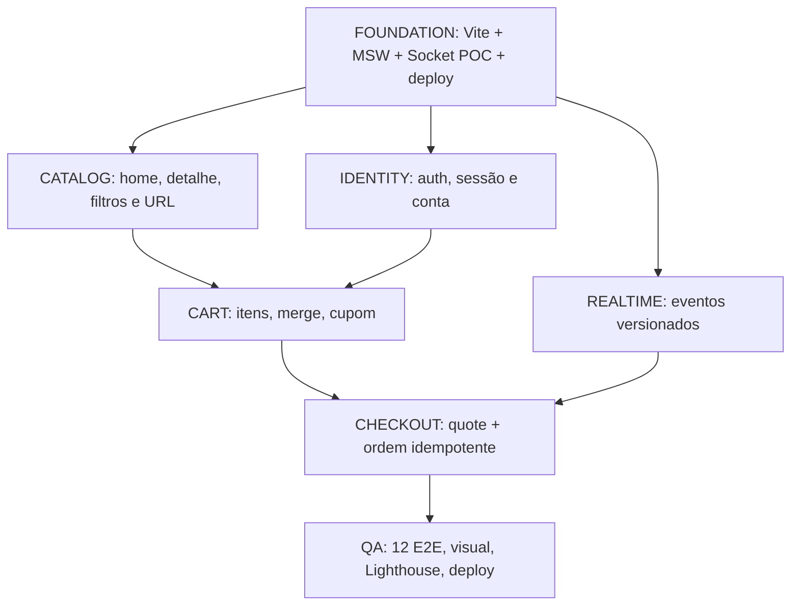

# TASKS — Plano executável por milestones

> **Status:** itens marcados foram comprovados no escopo descrito; itens desmarcados permanecem pendentes, mesmo quando há trabalho parcial. `RF`, `RNF` e `RN` referem-se aos documentos de requisitos e regras de negócio. Critério eliminatório precede refinamento secundário.

## Estado atual e validação mais recente

- **M0-02 validado; M0-05 parcial:** schemas de domínio e query keys compartilhadas cobrem catálogo, sessão, perfil, carteiras, favoritos, carrinho, cotação, pedidos, eventos e erros REST. Sessão, perfis, favoritos, carteiras e carrinho visitante persistem e são resetáveis. Faltam o estado de pedidos, isolamento do carrinho de conta, cenários adicionais e reset integral entre bases.
- **M2-03 validado:** favoritos autenticados persistem por usuário, com rollback em falha. A página reutiliza a sidebar da conta; o acesso está no perfil e no menu inferior mobile.
- **M2-04 parcial:** perfil e cadastro/edição de duas carteiras por usuário funcionam; seleção no checkout, conexão/recusa/desconexão e e-mail editável permanecem pendentes.
- **Checkout e pedidos:** a tela de pagamento continua sendo prévia; não há confirmação de pedido real, cotação revalidada ou recibo de compra confirmado.
- **Evidência histórica:** a última suíte completa no preview passou com 64 testes após a página de carteiras. Após o ajuste de navegação de favoritos, typecheck, build, verificação de tokens e 17 testes direcionados no preview passaram; capturas desktop/mobile foram inspecionadas. Não foram reexecutados nesta atualização documental.
- **Entrega:** baselines visuais, auditoria Lighthouse e deploy público seguem pendentes. Publicação exige autorização explícita.

## Roadmap e dependências



## M0 — Fundação e viabilidade do desafio

- [x] `M0-01` — Instalar Vite/React/TS strict, Tailwind/shadcn, Router, Query, Axios, MSW, Playwright (RNF-001/019). **Validado:** configuração, build e smoke tests; UI e rotas são uma fundação, não as telas finais.
- [x] `M0-02` — Definir schemas/DTOs e query keys compartilhadas (RF-001–RF-049). **Validado:** Zod cobre API/erros REST, catálogo/edições/filtros/paginação, sessão, perfil/avatares, carteiras, favoritos, carrinho/cotação, pedidos e eventos; query keys normalizam catálogo e particionam dados privados por usuário. Endpoints e fluxos futuros continuam em seus milestones próprios.
- [ ] `M0-03` — REST MSW retorna catálogo via Axios, com estado de loading e erro (RF-001/008). **Parcial:** catálogo via Axios/Query/MSW e cenários reproduzíveis estão implementados; cobertura completa dos estados de erro/loading e respostas fora de ordem continua pendente.
- [ ] `M0-04` — Spike Socket.IO real com binding e eventos `nft.updated` (RF-043/045). **Parcial:** handshake, `probe`, `nft.updated`, `order.updated` e nova conexão manual passaram em desenvolvimento e preview; faltam reconexão automática após interrupção, eventos antigos/duplicados e validação em ambiente publicado.
- [ ] `M0-05` — Reset/persistência determinísticos com dois usuários (RF-017/049). **Parcial:** sessão, perfis, favoritos, carteiras e carrinho visitante persistem e podem ser resetados; faltam pedidos, carrinho de conta e reset integral entre bases.
- [ ] `M0-06` — Publicar build mínimo e testar refresh de rota (RF-057). **Parcial:** acesso direto e refresh passaram no preview local; publicação e validação pública não foram realizadas.

### Evidências históricas da fundação — 05/11/2026

- `npm run typecheck`: passou; `npm run build`: passou.
- `CHROMIUM_PATH=/usr/bin/chromium npm run test:smoke`: 2 testes passaram em desenvolvimento.
- `CHROMIUM_PATH=/usr/bin/chromium SMOKE_PREVIEW=1 npm run test:smoke`: 2 testes passaram no preview do build.
- Os testes verificam resposta REST de diagnóstico, conexão e eventos de socket, nova conexão manual, acesso direto, refresh e 404. Não comprovam cenários de negócio nem recuperação automática da conexão.
- Naquela etapa inicial, catálogo, sessão, carrinho e checkout ainda eram placeholders. Consulte o estado atual acima para os avanços posteriores.

## M1 — Descoberta e catálogo

- [ ] `M1-01` — Shell visual, tokens derivados do protótipo inspecionado pelo MCP do Pencil, inventário de assets e grids (RF-050–053). **Parcial:** Home desktop, grid, tokens e quatro assets locais do Pencil implementados; fidelidade integral, inventário completo e comparação visual detalhada continuam pendentes; a Home mobile, o footer e a navegação inferior foram adaptados ao frame do Pencil.
- [ ] `M1-02` — Busca, filtros combinados, sort e paginação na URL (RF-001–008). **Parcial:** busca, coleção, rede, faixa de preço, ordenação e página passam por Axios/MSW e URL; faltam testes completos de falha, respostas fora de ordem e cenários resetáveis.
- [ ] `M1-03` — Detalhe, seleção de edição e quantidade, 404 e indisponibilidade (RF-009–011). **Parcial:** detalhe desktop via Axios/MSW, edições e limites, 404 e relacionados; faltam galeria completa, checkout real e regressão visual formal; a variante mobile foi adaptada e testada.
- [ ] `M1-04` — Testes E2E-01 e E2E-02, incluindo respostas fora de ordem.

### Evidência da fundação visual — 05/11/2026

- `npm run check:tokens`, `npm run typecheck` e `npm run build`: passaram.
- `CHROMIUM_PATH=/usr/bin/chromium SMOKE_PREVIEW=1 npm run test:smoke`: 5 testes passaram, incluindo cores e fonte no navegador, foco por teclado e ausência de overflow em 390, 768 e 1440 px.
- Os testes verificam o shell de diagnóstico; não comprovam fidelidade das telas do marketplace nem acessibilidade completa. A checagem automática de tokens cobre apenas padrões de cores literais.

### Home desktop — implementação parcial

- Home e catálogo usam quatro imagens locais da referência, filtros por coleção/rede/preço, busca, ordenação e paginação via `GET /api/nfts`; fixtures em memória não fornecem persistência nem reset. O detalhe e os fluxos de conta/carrinho ainda são placeholders.
- O botão, checkbox, input, select, card, skeleton e sheet seguem o padrão de componentes shadcn/ui. A regra de preferência por shadcn está registrada nas instruções do projeto.
- `npm run check:tokens`, `npm run typecheck`, `npm run build` e `CHROMIUM_PATH=/usr/bin/chromium SMOKE_PREVIEW=1 npm run test:smoke` passaram: 7 testes. A inspeção visual desktop foi realizada; não há baseline visual nem auditoria de acessibilidade/Lighthouse.

### Home mobile e footer

- Curva da navegação inferior reproduzida com o caminho vetorial do frame mobile; botão central, área segura e filtros em Sheet acessível implementados. O footer inclui as seções de benefícios, contato e navegação; newsletter e recursos sem implementação não simulam sucesso.
- `npm run check:tokens`, `npm run typecheck` e `npm run build`: passaram. `CHROMIUM_PATH=/usr/bin/chromium SMOKE_PREVIEW=1 npm run test:smoke`: 9 testes passaram. A tela mobile foi inspecionada em 414 px. A primeira tentativa após a inspeção não iniciou por porta ocupada; passou após encerrar o preview.
- As abas de novos lançamentos e em alta, favoritos, conta e carrinho ainda dependem dos respectivos fluxos; fidelidade pixel a pixel, baseline visual e Lighthouse seguem pendentes.

### Detalhe desktop

- `GET /api/nfts/:id` consulta a mesma fixture do catálogo, retorna 404 e fornece edições com estoque; a resposta é validada com Zod. A interface permite trocar de edição e respeita o estoque. Compra e favoritos permanecem desabilitados até a implementação de seus fluxos.
- `npm run check:tokens`, `npm run typecheck` e `npm run build` passaram; `CHROMIUM_PATH=/usr/bin/chromium SMOKE_PREVIEW=1 npm run test:smoke` passou com 11 testes, incluindo acesso direto, 404, edição, limite de quantidade e navegação relacionada. O detalhe desktop foi inspecionado visualmente.
- Há apenas uma imagem real por NFT; detalhes completos, persistência do mock, galeria e comparação visual formal permanecem pendentes.

### Detalhe mobile

- Frame mobile adaptado com imagem, painel sobreposto e barra fixa de quantidade, preço e carrinho. O desktop mantém galeria e controles em colunas. Favoritos permanecem indisponíveis; a fixture fornece somente uma imagem por NFT.
- `npm run check:tokens`, `npm run typecheck` e `npm run build` passaram. `CHROMIUM_PATH=/usr/bin/chromium SMOKE_PREVIEW=1 npm run test:smoke`: 20 testes passaram, incluindo seleção, quantidade e inclusão no carrinho em 320, 390 e 414 px e verificação estrutural desktop. Comparação visual realizada em 414 px; baseline formal permanece pendente.

## M2 — Identidade e conta

- [ ] `M2-01` — Registro/login/session/logout e retorno após acesso protegido (RF-012–017). **Parcial:** cadastro, login, sessão, expiração no refresh, logout e proteção do checkout implementados; tratamento de expiração em tela aberta pendente.
- [ ] `M2-02` — Scope privado, limpeza no logout e troca A→B; proibir acesso a pedido alheio (RF-017/022).
- [x] `M2-03` — Favoritos otimizados com rollback (RF-023): sessão, isolamento por usuário, persistência, reset e falha de mutation validados no preview.
- [ ] `M2-04` — Perfil, avatar, senha e carteiras (RF-018–021). **Parcial:** perfil, avatar, senha e cadastro/edição de carteiras implementados para a sessão; alteração de e-mail e integração das carteiras ao checkout pendentes.
- [ ] `M2-05` — E2E-03, E2E-04 e E2E-08.

### Login e sessão — implementação parcial

- Diálogo inspirado no frame desktop do Pencil com validação, exibição de senha, erro genérico de credenciais e fechamento por teclado. Login, consulta da sessão e logout passam por Axios/MSW; tokens e sessões fictícios persistem no navegador por até 24 horas. Checkout redireciona visitantes e retoma destino local validado. Contas de teste estão no README.
- Testes Playwright de login inválido/válido, retorno, refresh, logout, expiração após refresh, redirect externo e layout mobile passaram; captura em 390 px inspecionada. A suíte completa passou no preview: 34 testes. `npm run typecheck`, `npm run build` e `npm run check:tokens` passaram.
- Pendentes: recuperação de senha e login social; carrinho por usuário e merge (o carrinho atual ainda é do visitante), proteção/autorização das demais áreas privadas, teardown de socket de sessão, expiração em tela aberta e verificação de isolamento A→B. O mecanismo local não é segurança de produção.

### Cadastro de conta

- Diálogo de cadastro pelo frame do Pencil, com validação de nome, e-mail, senha e confirmação. O endpoint `POST /api/auth/register` valida, normaliza e detecta conflito; usuário e sessão são gravados atomicamente no IndexedDB. Novas senhas usam PBKDF2 com salt aleatório. Após cadastro, a sessão é iniciada e o retorno local é preservado entre login e cadastro.
- `npm run check:tokens`, `npm run typecheck`, `npm run build` e a suíte Playwright no preview passaram: 39 testes, incluindo persistência e novo login, concorrência de cadastro, duplicidade, migração de sessões, redirect externo e viewport de 390 px. A tela mobile foi inspecionada; comparação visual formal desktop ainda não foi feita.
- Carrinho por conta e merge, demais áreas privadas, expiração durante a navegação, recuperação de senha e login social seguem pendentes. A autenticação local simulada não equivale a um backend seguro de produção.

- Ícones de Google e Facebook exportados do Pencil e aplicados aos botões de login e cadastro; login social permanece indisponível. `check:tokens`, `typecheck`, build e 9 testes Playwright de autenticação passaram no preview; captura mobile inspecionada.

### Login e cadastro mobile

- Frames mobile do Pencil adaptados em tela inteira com marca, campos, navegação entre formulários e botões sociais; diálogo mantém fechamento por teclado e rolagem para telas baixas. O layout desktop e os fluxos existentes de sessão são preservados.
- Capturas de login e cadastro inspecionadas; testes de login/cadastro e retorno ao checkout em 320, 390 e 414 px passaram. `npm run check:tokens`, `npm run typecheck`, `npm run build` e 15 testes Playwright direcionados de autenticação e pagamento no preview passaram. Login social e recuperação de senha permanecem indisponíveis.

### Interações da navegação mobile

- Menu inferior da home mostra a quantidade do carrinho, destaca início/catálogo e fornece feedback de pressão com suporte a movimento reduzido. O ícone de conta autenticada abre um popover acessível com identidade e ação explícita de logout; favoritos seguem indisponíveis.
- `npm run check:tokens`, `npm run typecheck`, `npm run build` e 4 testes Playwright do menu no preview passaram; 10 testes direcionados de menu, autenticação e carrinho também passaram antes do ajuste visual final. O menu permanece restrito à home, como no layout existente.

### Cards e rodapé mobile

- Cards promocionais e editoriais abaixo da paginação usam uma coluna e ocupam toda a largura disponível no mobile. O rodapé foi extraído para `src/components/layout/site-footer.tsx`, com estilos próprios e seções adaptadas a telas estreitas; home, detalhes, carrinho e checkout reutilizam o componente.
- `npm run check:tokens`, `npm run typecheck`, `npm run build` e 19 testes Playwright direcionados no preview passaram, incluindo largura dos cards em 320/414 px, navegação do rodapé e presença no carrinho e detalhes. A inspeção visual formal permanece pendente.

### Perfil do colecionador

- Tela desktop baseada no frame do Pencil, com adaptação responsiva, carregamento e erro. `/account` exige sessão; `GET/PATCH /api/profile` e `POST /api/profile/password` validam a sessão no MSW e persistem dados por usuário. Nome, usuário, ENS e apelido, senha e avatar persistem: a aplicação aceita PNG/JPEG/WebP de até 10 MB, corrige orientação quando disponível, redimensiona, converte para WebP e limita o dado salvo a 500 KB. Mudança de e-mail e integração das carteiras ao checkout seguem pendentes.
- Testados acesso sem sessão, persistência após refresh, troca entre contas A/B, nome sincronizado com sessão, erro de senha, nova senha, avatar e layout 320 px. A captura desktop foi inspecionada. `check:tokens`, `typecheck` e build passaram; a suíte completa teve 54 testes aprovados antes dos últimos ajustes de campos e sincronização, seguidos por 13 testes direcionados aprovados. Uma primeira tentativa de teste e outra após os botões de senha falharam por seletores/tempo; foram corrigidas e reexecutadas.
- Pendentes: e-mail editável, carteiras e autorização das demais áreas privadas, controles de concorrência no mock e auditoria completa de acessibilidade/visual. Persistência local é somente demonstrativa.

## M3 — Carrinho e cotação

- [ ] `M3-01` — Carrinho visitante/conta, atualização de quantidade e remoção (RF-024–026). **Parcial:** visitante persistido em IndexedDB, com inclusão, edição e remoção via Axios/MSW; conta e isolamento por usuário ainda pendentes.
- [ ] `M3-02` — Merge transacional após autenticar, sem duplicação (RF-027).
- [ ] `M3-03` — Cupom e totais ETH decimal string pela API (RF-028–029). **Parcial:** cotação de demonstração versionada e cupons KURIO10/EXPIRADO, via MSW e Decimal; integração com checkout e cenários de alteração de preço pendentes.
- [ ] `M3-04` — Mudanças de estoque/preço na UI e invalidação de quote (RF-030).
- [ ] `M3-05` — E2E-05 e casos de estoque/cupom/refresh.

### Carrinho desktop — visitante

- Inclusão a partir do detalhe, edição e remoção por edição passam por Axios/MSW; IndexedDB persiste carrinho e cupom do visitante. O mock valida estoque e quantidades inteiras e calcula subtotal, desconto e taxa estimada de 0.016 ETH com Decimal via `POST /api/quotes`. Cupom `KURIO10` concede 10%; `EXPIRADO` exercita erro.
- `npm run check:tokens`, `npm run typecheck`, `npm run build` e `CHROMIUM_PATH=/usr/bin/chromium SMOKE_PREVIEW=1 npm run test:smoke` passaram; 13 testes incluem persistência, preço, cupons e rejeição de estoque/quantidade. O carrinho desktop foi inspecionado visualmente.
- Checkout está desabilitado. Sessão, merge, preço/estoque em tempo real, cenários resetáveis e isolamento por usuário permanecem pendentes.

### Correção do acesso à revisão

- A cor do link “Continuar explorando” foi isolada para não sobrescrever o texto do botão de revisão. `check:tokens`, `typecheck`, build e 5 testes Playwright de checkout/carrinho mobile passaram no preview; o teste verifica as cores computadas e a navegação.

### Carrinho mobile

- Layout adaptado ao frame do Pencil, com cabeçalho de retorno, cartões, controles de quantidade e resumo. O controle de remoção permanece disponível em cada item e o checkout segue desabilitado.
- `npm run check:tokens`, `npm run typecheck` e `npm run build` passaram. `CHROMIUM_PATH=/usr/bin/chromium SMOKE_PREVIEW=1 npm run test:smoke` passou com 16 testes, incluindo interações e ausência de overflow em 320, 390 e 414 px. Comparação visual realizada em 414 px; regressão visual formal permanece pendente.

## M4 — Compra, tempo real e recuperação

- [ ] `M4-01` — Formulários e fluxo checkout protegidos, rede e carteira (RF-031–033). **Parcial:** prévia desktop com campos e resumo, protegida por sessão; validação de envio, carteiras e fluxo completo pendentes.
- [ ] `M4-02` — Cotação autoritativa + revalidação + reconfirmação (RF-034–035). **Parcial:** prévia consulta cotação versionada ao abrir; faltam expiração, comparação de alterações e reconfirmação para pedido.
- [ ] `M4-03` — Pedido com chave idempotente, snapshot imutável, recibo confirmado (RF-036–042). **Parcial:** prévia visual demonstrativa; pedidos e recibos reais ainda não implementados.
- [ ] `M4-04` — Realtime para NFT e pedido, versões, ownerScope e cleanup (RF-043–047).
- [ ] `M4-05` — Cenários de timeout após commit, reconnect, old events e reset (RF-048–049).
- [ ] `M4-06` — E2E-06, E2E-07, E2E-09 e E2E-10.

### Pagamento desktop — prévia

- Frame de pagamento adaptado com formulário de prévia e resumo do carrinho. `GET /api/cart` e `POST /api/quotes` fornecem os valores; dados do formulário não são salvos. O carrinho oferece acesso à revisão somente com cotação disponível.
- A revisão agora exige sessão; conexão de carteira e confirmação permanecem desabilitadas até validação, idempotência e pedidos serem implementados. A rota de recibo mostra indisponibilidade para pedidos reais e oferece uma prévia separada.
- `npm run check:tokens`, `npm run typecheck`, `npm run build` e `CHROMIUM_PATH=/usr/bin/chromium SMOKE_PREVIEW=1 npm run test:smoke` passaram; 22 testes, incluindo carrinho vazio, cupom, refresh e confirmação desabilitada. Tela desktop inspecionada visualmente; fidelidade integral e frame mobile ainda não validados.

### Pagamento mobile — prévia

- Adaptação do frame mobile do Pencil com retorno ao carrinho, estado de carteira, opções de conexão desabilitadas, cotação do carrinho, acesso expansível aos dados de revisão e botão fixo de confirmação desabilitado. Sem carteira implementada, o estado vazio substitui as carteiras conectadas fictícias do frame.
- Captura em 414 px inspecionada; testes de autenticação, cotação, retorno, expansão e ausência de overflow em 320, 390 e 414 px passaram. `npm run check:tokens`, `npm run typecheck`, `npm run build` e a suíte completa no preview passaram (42 testes). A primeira execução dos testes direcionados falhou por seletores que não consideravam o rótulo alterado e elementos ocultos; corrigidos e reexecutados.
- Cadastro/seleção/conexão de carteiras, confirmação, pedidos e isolamento/merge do carrinho por usuário continuam pendentes; o formulário permanece uma prévia e não salva dados.

### Confirmação de pedido — prévia demonstrativa

- `/orders/preview` apresenta o comprovante conforme o frame desktop do Pencil, com dados de demonstração obtidos por Axios de `GET /api/orders/preview` interceptado pelo MSW. O checkout inclui acesso explícito à prévia; nenhum pedido é criado ou confirmado. Outros IDs mostram indisponibilidade e o explorador está desabilitado.
- A prévia foi testada em 390 e 1440 px, sem overflow horizontal; captura desktop inspecionada. `npm run check:tokens`, `npm run typecheck`, `npm run build` e a suíte Playwright no preview passaram (30 testes). O estado de falha de rede da prévia e a fidelidade visual mobile ainda não foram verificados.
- Pendentes: criação idempotente, estados de pedido, consulta autorizada, recibo snapshot de pedido confirmado, recuperação e reconciliação. A prévia não satisfaz esses requisitos.

### Feedback de interação

- Hover e pressão aplicados aos controles e links disponíveis, com foco visível e respeito a `prefers-reduced-motion`; estados desabilitados não recebem efeito de pressão. Tokens de duração e escala são provisórios.
- `npm run check:tokens`, `npm run typecheck` e `npm run build` passaram; 4 testes Playwright direcionados de interação e checkout passaram no preview. A primeira execução teve falha no teste por acionar a navegação ao soltar o mouse; a sequência foi corrigida e reexecutada. A auditoria completa de acessibilidade e a regressão visual seguem pendentes.

### Cards e navegação do rodapé

- Cards de NFT no catálogo, carrinho e detalhes abrem o produto por toda a área de conteúdo; a imagem recebe aproximação suave no hover/foco, desativada com movimento reduzido. Cards de destaques e do diário apresentam aviso acessível quando o conteúdo não existe.
- Categorias do rodapé abrem o catálogo filtrado pela URL. Perfil aponta para a rota existente, ainda não implementada; ajuda, redes, carteiras e contatos de exemplo informam indisponibilidade. A inscrição na newsletter segue desabilitada.
- Validados `npm run check:tokens`, `npm run typecheck`, `npm run build` e `CHROMIUM_PATH=/usr/bin/chromium SMOKE_PREVIEW=1 npm run test:smoke`: 27 testes passaram no preview. A primeira tentativa do Playwright falhou porque o sandbox bloqueou a porta local; a execução com permissão para o servidor passou. Revisão visual integral e auditoria de acessibilidade permanecem pendentes.

- Rodapé: textos de links e botões usam `--text-primary` (`#f5f1eb`); hover usa `--action-primary`, sem sublinhado. `npm run check:tokens`, `npm run typecheck` e `npm run build` passaram após o ajuste; inspeção visual específica permanece pendente.

## M5 — Qualidade, operações e entrega

- [ ] `M5-01` — Acessibilidade, teclado, foco, skeleton, reduced-motion (RF-051–053).
- [ ] `M5-02` — E2E-11 e E2E-12 em Chromium desktop/mobile; relatórios/traces (RF-054).
- [ ] `M5-03` — Baselines visuais de 4 telas (RF-055).
- [ ] `M5-04` — 3× Lighthouse em home/detalhe × desktop/mobile; mediana LCP/CLS/TBT (RF-056).
- [ ] `M5-05` — Documentação de comandos, fixtures, reset, políticas e limites (RF-058–059).
- [ ] `M5-06` — Deploy final reproduzível, refresh de todas as rotas e MSW/socket (RF-057).

## Modelo de ficha de tarefa

```text
ID:
RF/RNF/RN:
Objetivo observável:
Contratos / schemas:
Dependências:
Arquivos esperados:
Fluxo feliz e de falha:
Teste automatizado / manual:
Evidência da execução:
Status real:
```

**Critérios de pronto:** [Definition of Ready / Done](06-qualidade/definition-of-done.md). **Riscos:** [Spikes](07-planejamento/spikes-e-dependencias.md). **Mapa de testes:** [Rastreabilidade](06-qualidade/matriz-de-testes-e-requisitos.md).

### Fundação A1/A2 — registro histórico do incremento inicial

- Contratos Zod compartilhados agora cobrem usuário/sessão, catálogo/edição/filtros, carrinho/cotação, perfil/avatar, favoritos, carteiras, pedidos, eventos e prévia de recibo. `api.ts` centraliza o envelope de erro e aceita `fieldErrors` retornados pelos handlers; ETH é normalizado como string decimal, sem cálculo com `number`.
- As chaves existentes foram centralizadas em `src/lib/query-keys.ts` sem alterar a key pública do visitante. Catálogo normaliza os filtros antes da key; perfil, favoritos, carteiras e pedidos incluem o usuário; carrinho e cotação explicitam visitante ou usuário. Query usa os defaults do TanStack (incluindo três retries no cliente), exceto as consultas que já definem `retry: false`; mutations invalidam as chaves existentes. Não foi implementado o isolamento de carrinho de conta nem merge.
- `POST /api/__test/reset` limpa sessões, usuários cadastrados, perfis e carrinhos persistidos e restaura as duas contas de fixture. As duas bases IndexedDB são limpas sequencialmente, não em uma transação atômica entre bases. A chamada não limpa token local nem cache Query de uma página já aberta; testes devem reiniciar a página/estado do cliente após reset. Pedidos, favoritos e carteiras ainda não possuem repositórios. O endpoint existe apenas quando o worker mock está ativo.
- Cenários configuráveis de latência, rede, erros e conflitos, reset integral de recursos futuros e a validação de todas as fronteiras quando os endpoints de pedidos/realtime forem implementados permanecem pendentes; M0-05 continua aberto. A compatibilização preserva os DTOs e handlers já ativos e acrescenta contracts futuros sem mudar formatos REST existentes.
- Validação deste incremento: `npm run typecheck`, `npm run build` e `npx playwright test --workers=1 --reporter=dot` passaram (66 testes). Os testes de contrato validam ETH, paginação, erros, query keys e eventos; o teste de perfil confirma que PNG enviado vira WebP automaticamente antes da persistência simulada. A execução paralela expõe interferência do cenário global de catálogo em dois testes de loading; a suíte serial é a evidência reproduzível até o isolamento desse cenário ser implementado.

### Rodapé nas telas indicadas

- Por solicitação do usuário, o rodapé compartilhado foi removido de pagamento e perfil; permanece em início, detalhes do NFT e carrinho. A informação anterior de que o checkout reutilizava o rodapé descreve o estado anterior a esta alteração.
- `npm run check:tokens`, `npm run typecheck` e `npm run build` passaram. No preview, 16 testes direcionados de pagamento, perfil e início passaram, incluindo presença do rodapé em carrinho/detalhes e ausência em pagamento/perfil. Não foi realizada nova comparação visual formal.


### Favoritos — 05/11/2026

- Página `/favorites`, ações no detalhe e navegação via perfil e menu mobile; o ícone do cabeçalho foi posteriormente removido. Endpoints Axios/MSW autenticados, persistência IndexedDB por usuário, reset e atualização otimista com rollback. Sem frame específico no Pencil, a página adapta os padrões existentes e não inclui rodapé.
- `npm run typecheck`, `npm run check:tokens` e `npm run build` passaram; `CHROMIUM_PATH=/usr/bin/chromium SMOKE_PREVIEW=1 npm run test:smoke` passou com 61 testes. Inclui sessão obrigatória, A/B, persistência, remoção, rollback, reset e mobile; estado vazio inspecionado em desktop e mobile. Expiração durante navegação continua pendente em B1.


### Carteiras — implementação parcial

- Formulário de carteira principal e secundária em `/account/wallets`, baseado no frame desktop do Pencil e adaptado para mobile; `GET/POST/PATCH /api/wallets` são autenticados e persistem por usuário, com validação e reset. Carteiras de outras contas retornam 404 ao editar. O uso de dados é simulado e não solicita segredos.
- Seleção no checkout, conexão/recusa/desconexão e exclusão permanecem pendentes. Entradas anteriores sobre indisponibilidade de carteiras representam o estado histórico anterior a esta etapa.

- Validação: `npm run check:tokens`, `npm run typecheck` e `npm run build` passaram; a suíte Playwright no preview passou com 64 testes. Após acrescentar uma verificação de rejeição HTTP 422 e a indicação acessível dos campos obrigatórios, os 3 testes direcionados de carteiras passaram novamente. Foram inspecionadas capturas em 1440 e 390 px. A primeira execução direcionada teve falha de seletor; a seguinte detectou reload antes da conclusão do salvamento. Ambas foram corrigidas e reexecutadas.

### Navegação de favoritos

- A página de favoritos reutiliza a sidebar de conta e destaca “Lista de interesse”. O ícone de favoritos foi removido do cabeçalho; o acesso permanece pelo perfil e pelo menu inferior mobile, conforme solicitado.
- `npm run check:tokens`, `npm run typecheck` e `npm run build` passaram. No preview, 17 testes direcionados de favoritos, perfil, carteiras e navegação mobile passaram; capturas em 1440 e 390 px foram inspecionadas.

### Campo de cupom

- Campo e botão de aplicação compartilham o contorno, com junção arredondada; foco por teclado permanece visível no grupo. A mudança usa tokens existentes.
- `npm run check:tokens`, `npm run typecheck`, `npm run build` e 5 testes direcionados de carrinho desktop/mobile no preview passaram. O campo foi inspecionado em desktop e mobile; o contorno de foco do grupo foi verificado no navegador.
- Ajuste complementar: borda esquerda do botão removida; largura computada de 0 px e foco do grupo verificados no navegador. `check:tokens`, typecheck, build e 5 testes de carrinho no preview passaram.

### Pesquisa no cabeçalho

- A lupa abre um formulário acessível e pesquisa no catálogo via parâmetros da URL. Na Home, a pesquisa preserva os filtros existentes e volta à primeira página; nas demais rotas, usa filtros padrão. Escape fecha o formulário e devolve o foco à lupa. O popover é uma adaptação provisória: o frame inspecionado mostra apenas o ícone.
- `npm run check:tokens`, `npm run typecheck` e `npm run build` passaram; 9 testes direcionados de pesquisa, catálogo e interação passaram no preview. Capturas em 1440 e 768 px foram inspecionadas, sem overflow horizontal em 768 px.

### Validação antes dos commits

- `npm run check:tokens`, `npm run typecheck` e `npm run build` passaram. `CHROMIUM_PATH=/usr/bin/chromium SMOKE_PREVIEW=1 npm run test:smoke -- --workers=2` passou com 66 testes.
- Uma execução anterior teve 65 aprovados e falha no teste de favoritos ao navegar após a atualização otimista sem aguardar a gravação. O teste foi ajustado para aguardar a resposta REST antes de verificar persistência. Outra execução foi interrompida e terminou com 60 aprovados e 6 timeouts; a suíte completa foi executada novamente com dois workers e passou.
